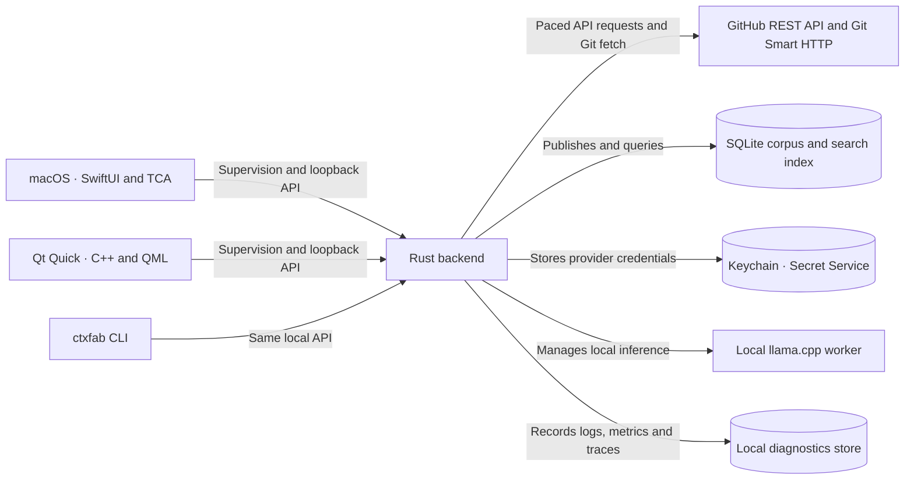

# Context Fabricator architecture

Context Fabricator indexes engineering sources locally and answers questions with verifiable citations. The native SwiftUI client, the Qt Quick client and the CLI use the same Rust service and OpenAPI contract. GitHub is the first connector.

## System overview

Each desktop distribution runs its own backend session. The application supervisor starts the Rust process and discovers its authenticated loopback endpoint. The backend runs scheduled collection for the lifetime of that session. The CLI attaches to the active profile. [Swift supervisor](desktop/macos/App/BackendSupervisor.swift) · [Qt supervisor](desktop/qt/src/platform/BackendSupervisor.cpp) · [OpenAPI contract](contracts/openapi.yaml)

## Module boundaries

| Module | Responsibility |
| --- | --- |
| [macOS desktop](desktop/macos/App) | SwiftUI renders backend responses. TCA stores own presentation state, typed UI actions and effects, and user feedback. A local presentation preference selects the system language or one of eight interface languages. Rust owns validation, effective product settings, KPIs and business rules. [Language preference](desktop/macos/App/AppLanguage.swift) |
| [Qt desktop](desktop/qt/src) | QML owns rendering, focus and layout. C++ feature models adapt generated API responses, sequence requests and retain presentation state. The transport and Rust process supervisor live under `src/platform`. [Qt client](desktop/qt/README.md) |
| [CLI](cli/README.md) | Discovers the running local service, sends commands through the shared API, and prints results and citations. |
| [Rust domain and application](backend/server/src/application) | Owns collection and publication rules, settings, search, answer orchestration, and application ports. [Domain types](backend/server/src/domain) · [Ports](backend/server/src/application/ports.rs) |
| [Backend adapters](backend/server/src/adapters) | Axum translates HTTP requests into use cases. Outbound adapters integrate GitHub, SQLite, the platform credential store and OpenTelemetry. [Composition](backend/server/src/composition) wires the implementations. |
| [Model management](backend/server/src/application/model_management.rs) | Owns the offline catalog, Hub discovery, installation jobs and removal of idle weights. The [Hugging Face adapter](backend/server/src/adapters/outbound/hugging_face.rs) validates compatible repositories and pinned artifacts. Discovery and transfers share one paced, counted transport. SQLite retains imported profiles and their verification state. The inference usage port protects active models during removal. The desktop consumes all actions through the generated OpenAPI client. |
| [Inference crate](backend/inference/README.md) | Owns embedding and generation profiles, native worker lifecycle and transport. The answer use case owns the evidence supplied to the model and the checks applied to the result. |

The backend follows hexagonal architecture. Use cases depend on ports for side effects. Connector settings in SQLite keep an opaque credential reference. The platform adapter stores the secret in Keychain or Secret Service through the credential port. [Credential port](backend/server/src/application/credentials.rs) · [Keychain](backend/server/src/adapters/outbound/keychain.rs) · [Secret Service](backend/server/src/adapters/outbound/secret_service.rs)

Each desktop stores its interface language preference locally and applies it through its own localization system. The answer language and answer history are independent settings owned by the backend and exposed through the local API. [Settings view](desktop/macos/App/PreferencesView.swift) · [OpenAPI settings](contracts/openapi.yaml)

## Collection and citations

1. Select a GitHub repository and branch. The desktop filters loaded branch names and requests additional pages through Rust. Scheduled refreshes and **Refresh Now** share collection jobs and request limits. Rust counts outbound attempts, including retries and pagination, and can defer work during provider cooldowns. [Branch listing](backend/server/src/application/github/branches.rs) · [Scheduler](backend/server/src/runtime/scheduler.rs)
2. Resolve the branch to a commit, fetch its Git objects through the Rust Git transport, and stage its file manifest. Reuse unchanged blobs and publish the completed snapshot atomically in SQLite. Search continues to use the previous complete snapshot until publication succeeds. [Git transport](backend/server/src/adapters/outbound/github/git.rs) · [Snapshot schema](backend/server/src/adapters/outbound/sqlite/migrations/0011_source_snapshots.sql)
3. Split files into bounded passages and preserve their original byte and line ranges. Search uses FTS5/BM25 and can combine it with local embeddings when the compatible index is ready. Scoped requests filter by repository and branch before ranking. [Retrieval](backend/server/src/application/retrieval.rs) · [CLI scope](cli/README.md)
4. Submit one question from Answers. The backend ranks local code, prepared history comparisons and observed workflow attempts. It reopens the admitted evidence and verifies quotes before returning an answer. GitHub code citations identify a pinned commit, path and original line range. [Answer use case](backend/server/src/application/answers.rs)

Each stream owns its projection and lookup. A scoped question applies its repository and branch filters in the code, history and Actions stores before ranking. Answers interleaves typed evidence from those stores, assigns passage IDs for the context that fits and resolves the same IDs back to the originating stream. Current code reopens source bytes. History reopens an immutable before/after pair. Actions reopens the recorded run and attempt. A changed or missing publication invalidates the affected draft. [Evidence selection](backend/server/src/application/answers/mixed.rs)

The GitHub connector keeps independent settings and publications for current code, history, Actions and the Rust graph. Each stream projects evidence from its own source records.

| Stream | Evidence and verification |
| --- | --- |
| Current code | Commit-pinned source passages with original byte and line ranges. SQLite verifies current or retained membership before returning a citation. |
| History | A bounded first-parent lineage refreshes during the app session. Each scheduled collection can prepare one recent comparison within a separate request ceiling. A separate FTS5 index ranks complete paired hunks for Answers. Rust reopens both Git blobs and checks the exact pair before returning citations. [History](backend/server/src/application/github/history.rs) · [Historical answers](backend/server/src/application/answers/history.rs) |
| Actions | Branch-scoped workflow definitions and observed run attempts. Answers reopen one selected run's recorded fields and cite its attempt URL. The workflow definition at a branch commit and the executed definition have separate provenance. [Collection](backend/server/src/application/github/actions.rs) · [Actions answers](backend/server/src/application/answers/actions.rs) |
| Rust graph | Tree-sitter provides exact sites for supported definitions, imports and qualified calls. Resolution is limited to proven module paths. Graph-only collection preserves a distinct owner and creates no general search rows. [Graph projection](backend/server/src/domain/github/graph.rs) |

Answers can use the local Rust graph to find source passages when a question names one fully qualified symbol, such as `crate::orders::submit`. A repository and branch scope restricts the lookup. A quoted Rust root path can further restrict it. For a desktop question without scope, the lookup requires exactly one matching definition across active Branch files and Rust graph publications. SQLite reads the graph definition, a resolved call and a resolved import in one transaction with the corresponding code publication. Each site must match its original file, blob, revision and identifier bytes. These ordinary source passages go through the same token budget, citation verification and immutable-source reopening as text search. The selection trace records structural candidates. Graph-only and retained publications supply no candidates to this path. A missing candidate conveys no claim about graph coverage or the absence of callers.

A transactional storage limit counts retained payload bytes across GitHub streams. Explicit data deletion clears that repository's local data and pauses collection while preserving its settings. Removing settings preserves locally retained evidence for scoped reads.

## Local inference

The Rust backend starts and supervises the local workers. The qualified profiles use Qwen3-Embedding-0.6B for retrieval and Qwen3-4B-Instruct-2507 for generation. The generation controller can cancel a request, warm a new profile before switching, and restore the confirmed profile on restart when its pinned fingerprint still matches. [Inference crate](backend/inference/README.md)

The macOS app packages a source-built arm64 llama.cpp runtime inside the bundle. The Ubuntu package includes a pinned x86-64 CPU runtime, verified against a manifest pinned into the backend. The backend and worker guardian verify the enclosing app and nested engine before using it. Pinned model transfers use the backend's paced transport. Verified answer weights are selectable in the running app. Verified embedding weights warm and index in the background, with BM25 available during rebuild. [Bundle verifier](backend/server/src/adapters/outbound/managed_runtime/bundled.rs)

The Rust catalog defines eligible setup models and the recommended answer model. Both desktop clients render the choices and report download progress. The setup coordinator estimates space, records confirmation and warms the selected profiles. SQLite retains the approved choices and operation phase across restarts. An embedding switch commits the selected profile after its readiness check. Each query and index write uses a single profile, with separate vectors for Q8_0 and F16. BM25 remains available while the selected profile's index is incomplete. The desktop clients and the CLI use the same local contract. [Setup coordinator](backend/server/src/application/inference_setup.rs) · [Vector migration](backend/server/src/adapters/outbound/sqlite/migrations/0037_document_vector_profiles.sql) · [Runtime packaging](quality/release/embed_runtime.py) · [Distribution gate](quality/release/check-distribution.sh)

Hugging Face discovery exposes separate generation and embedding searches. An embedding import binds the selected repository, revision and file to its confirmed SHA-256. The current embedding recipe uses 1,024 dimensions, last-token pooling and Qwen3 query preparation. The catalog accepts matching Qwen3-Embedding-0.6B GGUF variants, and each imported weight identity has its own vector profile. [Discovery adapter](backend/server/src/adapters/outbound/hugging_face/discovery.rs)

Settings uses the local retrieval API to select among verified installed embedding profiles. Rust holds the model reservation through the readiness check and commits the selected profile under the index transition lock. The switch preserves the index setting, stored vectors and answer-model selection. [Embedding selection](backend/server/src/application/inference_setup/embedding_selection.rs)

## Pipeline inspection and benchmark replay

**Inspect Pipeline** reads the same Rust answer pipeline used by **Answers**. Ordinary inspection requests use `POST /v1/answers` with transient inspection enabled. Benchmark requests use `POST /v1/benchmarks/answers` with temporary text, a loaded Git revision or an observed Actions attempt. A benchmark run uses isolated evidence with the shared answer use case. [OpenAPI contract](contracts/openapi.yaml) · [Benchmark handler](backend/server/src/adapters/inbound/http/answers/benchmark.rs)

- Rust owns corpus import, chunking, lexical and vector retrieval, ranking, context selection, generation and citation verification. Captured data exposes the available candidates, query embeddings and exact completion input, draft, and verification outcome.
- A downloaded reference is keyed by repository and commit. Multiple references and workflow attempts can remain available. Each pinned-corpus query selects one reference. Preparing a hybrid benchmark requires the selected embedding profile and a complete index for that reference.
- The desktop clients share the bundled English question data. The UI selects sources and questions, shows progress and presents the stages. Expected answers are comparison data for reviewers. A published response indicates that citation verification passed.

[Shared catalog](desktop/macos/App/Features/Diagnostics/Resources/) · [SwiftUI inspector](desktop/macos/App/Features/Diagnostics/AnswerPipelineView.swift) · [Qt inspector](desktop/qt/src/features/pipeline/) · [macOS screenshots](docs/SCREENSHOTS.md#pipeline-inspection) · [Qt screenshots](docs/SCREENSHOTS-QT.md#pipeline-inspection)

## Diagnostics and quality

The Rust backend embeds OpenTelemetry and stores logs, metrics and traces locally with bounded ingestion and retention. **Diagnostics** exposes request accounting, filtered logs and trace details. The same trace inspector can be opened from an answer to see the question, sources searched, candidates, verification outcome and related spans when available. [Telemetry adapter](backend/server/src/adapters/outbound/telemetry/README.md)

The project checks Rust, Swift, C++ and QML. Headless fixtures exercise the CLI, generated API clients and local Rust service. Native XCTest and the Qt window scenarios cover rendering, focus and keyboard navigation. The Qt matrix also exercises installed Linux packages. [Quality checks](quality/README.md) · [Release preparation](docs/RELEASE.md)
