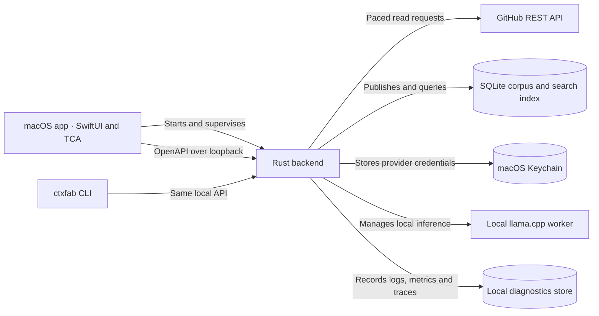

# Context Fabricator architecture

Context Fabricator is a local-first macOS app and CLI for indexing engineering sources and answering questions with verifiable citations. The current preview collects the code at a tracked GitHub branch, keeps the corpus on the Mac, and queries it from the desktop or terminal.

## System overview

The app bundle contains the desktop, backend, and CLI. The macOS launcher owns the backend process for the app session. Scheduled work runs while the app is open and stops on quit. Both clients use an authenticated loopback API defined by one OpenAPI contract. [macOS launcher](desktop/macos/App/BackendSupervisor.swift) · [OpenAPI contract](contracts/openapi.yaml)

## Module boundaries

| Module | Responsibility |
| --- | --- |
| [macOS desktop](desktop/macos/App) | SwiftUI renders backend responses. TCA stores own presentation state, typed UI actions and effects, and user feedback. Rust owns validation, effective settings, KPIs and business rules. |
| [CLI](cli/README.md) | Discovers the running local service, sends commands through the shared API, and prints results and citations. |
| [Rust domain and application](backend/server/src/application) | Owns collection and publication rules, settings, search, answer orchestration, and application ports. [Domain types](backend/server/src/domain) · [Ports](backend/server/src/application/ports.rs) |
| [Backend adapters](backend/server/src/adapters) | Axum translates HTTP requests into use cases. Outbound adapters integrate GitHub, SQLite, macOS Keychain and OpenTelemetry. [Composition](backend/server/src/composition) wires the implementations. |
| [Inference crate](backend/inference/README.md) | Owns embedding and generation profiles, native worker lifecycle and transport. The answer use case owns the evidence supplied to the model and the checks applied to the result. |

The backend follows hexagonal architecture. Use cases depend on ports for side effects. Connector settings in SQLite keep an opaque credential reference. The macOS Keychain adapter stores the secret value through the credential port. [Credential port](backend/server/src/application/credentials.rs) · [Keychain adapter](backend/server/src/adapters/outbound/keychain.rs)

## Collection and citations

1. Select a GitHub repository and branch. Scheduled refresh and **Refresh Now** use the same collection job and request limits. The backend counts outbound attempts, including retries and pagination, and can delay work during provider cooldowns. [GitHub collection](backend/server/src/application/github/current.rs) · [Scheduler](backend/server/src/runtime/scheduler.rs)
2. Resolve the branch to a commit and stage its file manifest. Reuse unchanged blobs and publish the completed snapshot atomically in SQLite. Search continues to use the previous complete snapshot until publication succeeds. [Snapshot schema](backend/server/src/adapters/outbound/sqlite/migrations/0011_source_snapshots.sql)
3. Split files into bounded passages and preserve their original byte and line ranges. Search uses FTS5/BM25 and can combine it with local embeddings when the compatible index is ready. Scoped requests filter by repository and branch before ranking. [Retrieval](backend/server/src/application/retrieval.rs) · [CLI scope](cli/README.md)
4. Generate a draft from selected passages. The backend reopens the cited passages and checks their quotes before returning the answer. GitHub citations identify a pinned commit, path and original line range. [Answer use case](backend/server/src/application/answers.rs)

History, GitHub Actions ingestion, code graph navigation, and additional connectors are planned.

## Local inference

The Rust backend starts and supervises the local workers. The qualified profiles use Qwen3-Embedding-0.6B for retrieval and Qwen3-4B-Instruct-2507 for generation. The generation controller can cancel a request or switch to an already provisioned profile during the app session. [Inference crate](backend/inference/README.md) · [Qualified model setup](quality/FOUNDATION.md#local-answer-qualification)

**Preview.** Developers install a compatible `llama-server` manually. The app can download pinned model weights through the backend's paced transport. A backend restart discovers newly downloaded profiles.

**Planned.** **Manage Models** will install a compatible runtime, download weights, report setup progress and activate the selected model in the running app.

## Diagnostics and quality

The Rust backend embeds OpenTelemetry and stores logs, metrics and traces locally with bounded ingestion and retention. **Diagnostics** exposes request accounting, filtered logs and trace details. The same trace inspector can be opened from an answer to see retrieval, generation and citation verification. [Telemetry adapter](backend/server/src/adapters/outbound/telemetry/README.md)

The project checks Swift and Rust formatting, linting, static analysis and coverage. Contract, concurrency, failure-recovery and packaged UI scenarios exercise behavior across boundaries. [Quality tooling](quality/README.md) · [Build and test commands](quality/FOUNDATION.md#checks)
