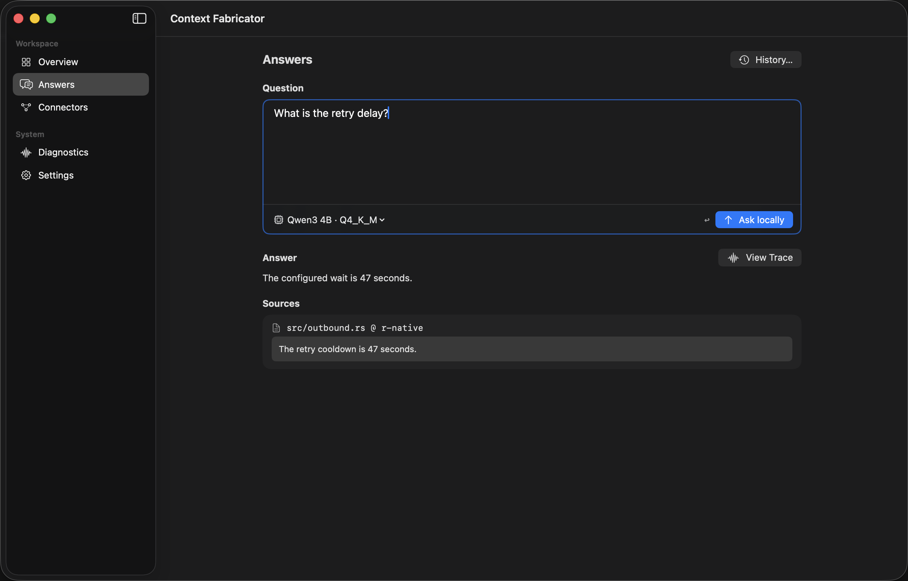
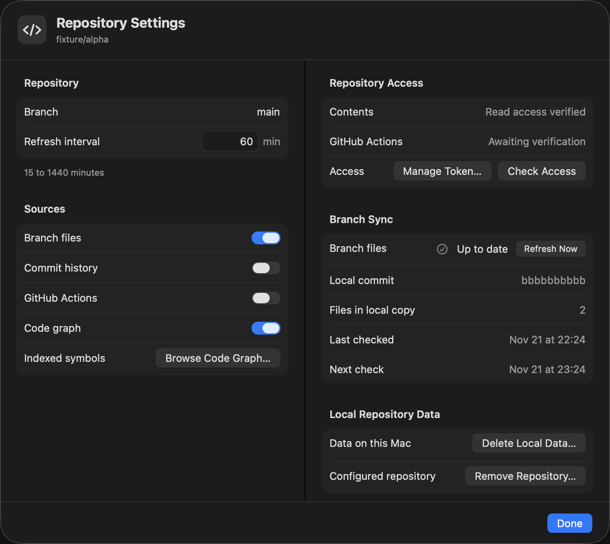
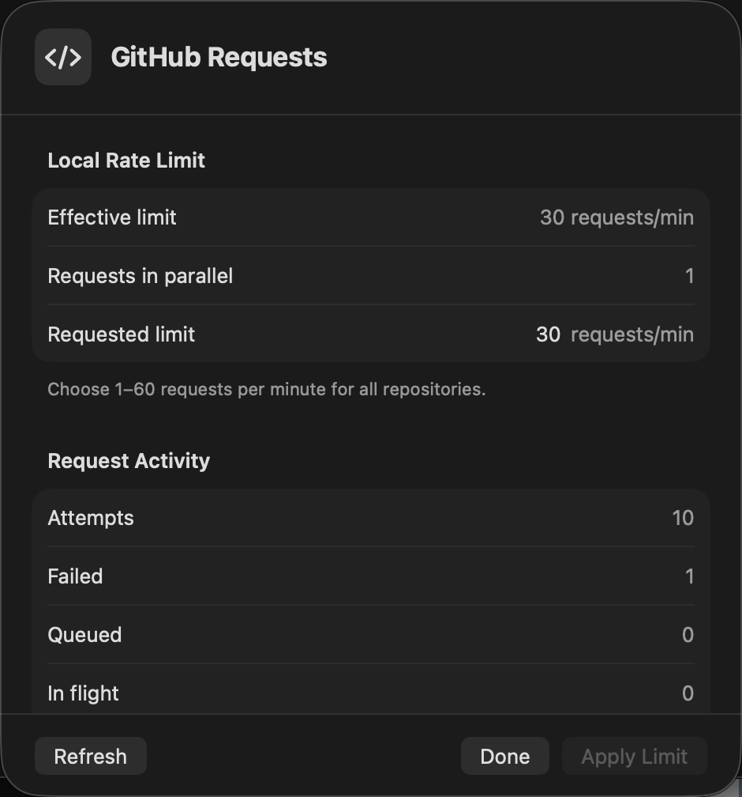
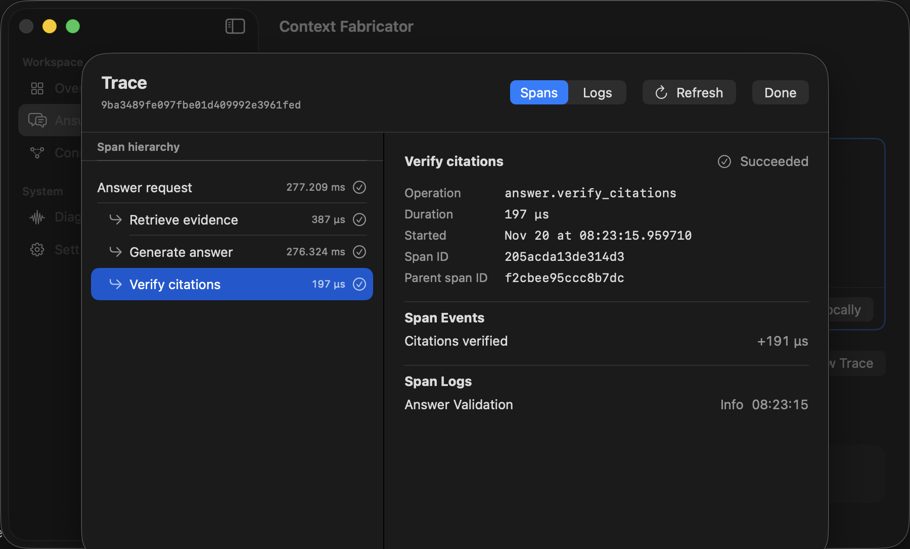

# Context Fabricator

**Ask questions about your GitHub repositories, with answers grounded in source you can open.**

Context Fabricator is a local-first macOS app and CLI. It indexes the branches you select, searches the index on your Mac, and runs a local model to answer questions. GitHub code citations link to the exact commit, file and lines.

> **Work in progress · Fully AI-generated implementation.** AI coding agents generate the code, tests and documentation. A human directs the product, makes architecture decisions and tests the app. The current preview builds from source on Apple Silicon.



*Screenshots show the native macOS app using synthetic test fixtures.*

## What works today

- **Read-only GitHub indexing.** Choose a repository and branch. Refresh on demand or on a schedule while the app is running. Credentials are stored in macOS Keychain. Request pacing and counters are visible in the connector.
- **Local search and answers.** SQLite/FTS5 provides BM25 search. Optional Qwen3 embeddings enable semantic and hybrid search. Qwen3 4B generates answers locally and the backend checks the quoted evidence.
- **Built-in diagnostics.** Search and filter logs, and inspect trace steps, timings and related events from Answers or Diagnostics.
- **Terminal access.** The bundled `ctxfab` CLI uses the same local backend and can scope search and answers to a repository and branch.

Commit history, GitHub Actions ingestion, code graph navigation and additional connectors are planned. Current-code collection and citations have been qualified on bounded fixtures.

| Repository refresh | Request limits and activity |
| --- | --- |
|  |  |



## Try it from source

Use Apple Silicon, macOS 26, Xcode 26.6 (17F113), and `jq`. Run from the repository root.

```sh
make bootstrap-app
make app
open ".quality/foundation-xcode/Build/Products/Debug/Context Fabricator.app"
```

1. Open **Connectors → GitHub** and use the browser setup to create a fine-grained token with **Contents: Read** for the repositories you select. Paste it into the app, add a repository and choose its branch. Open Repository Settings and use **Refresh Now** to queue a check.
2. **Temporary setup for local answers.** Extract the Apple Silicon runtime and keep its files together. Symlink its `llama-server` to `~/Library/Application Support/ContextFabricator/inference/llama-server`. In **Answers**, open the model picker and choose **Manage Models…** to download weights, then restart the backend. [Qualified llama.cpp build](https://github.com/ggml-org/llama.cpp/releases/tag/b12359) · [Model setup](quality/FOUNDATION.md#local-answer-qualification)

   The planned **Manage Models** flow will install the compatible runtime, download model weights, and activate the selected model in the running app. [Model lifecycle](ARCHITECTURE.md#local-inference)

3. Ask a question in **Answers** with **Command-Return**, or try the bundled CLI while the app is running.

```sh
CTXFAB=".quality/foundation-xcode/Build/Products/Debug/Context Fabricator.app/Contents/MacOS/ctxfab"
"$CTXFAB" status
"$CTXFAB" search "timeout"
```

See [CLI usage](cli/README.md) for repository filters, model controls and answer commands.

## Project layout

See [Architecture](ARCHITECTURE.md) for component boundaries, data flow, and the model lifecycle.

| Path | Responsibility |
| --- | --- |
| [desktop/macos](desktop/macos) | SwiftUI interface, TCA presentation state and macOS launcher. |
| [backend](backend) | Rust service for collection, SQLite storage, retrieval, inference adapters and observability. |
| [cli](cli) | Rust command-line client for the app's local service. |
| [contracts](contracts) | OpenAPI contract shared by the backend and its clients. |
| [quality](quality) | Build tooling, test fixtures and quality gates. Generated outputs go under `.quality/`. |

Use `make quality` for the toolchain gates and `make app-smoke` after a build to check the packaged service and CLI. The [foundation guide](quality/FOUNDATION.md#checks) lists the Swift, Rust, OpenAPI and native UI checks with their prerequisites.

## License

Context Fabricator is available under the [MIT License](LICENSE).
