# Context Fabricator screenshot gallery · Qt

The Qt Quick preview captured offscreen on macOS with the local Rust backend, synthetic repositories and a deterministic inference worker. Select any image to open it at full size. [Native macOS gallery](SCREENSHOTS.md)

[Answers](#local-answers) · [Inspect Pipeline](#pipeline-inspection) · [Model management](#model-management) · [GitHub](#github) · [Diagnostics](#diagnostics) · [Overview and settings](#overview-and-settings)

## Local answers

Ask about the local corpus, read the supporting source excerpt and open the corresponding trace. The history panel separates this session's questions from saved answers.

[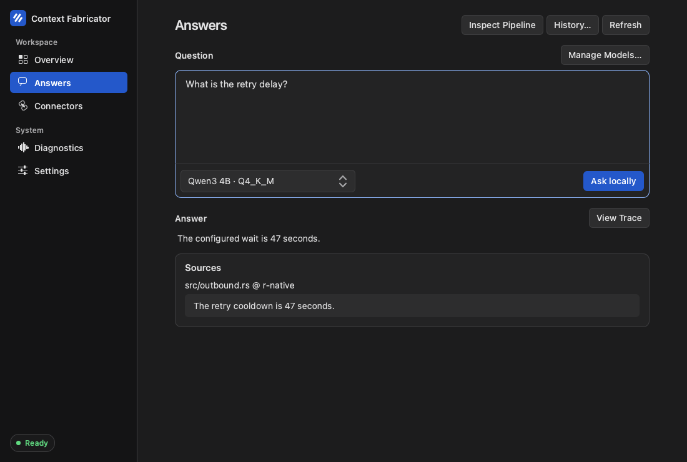](screenshots/qt/answers.png)

[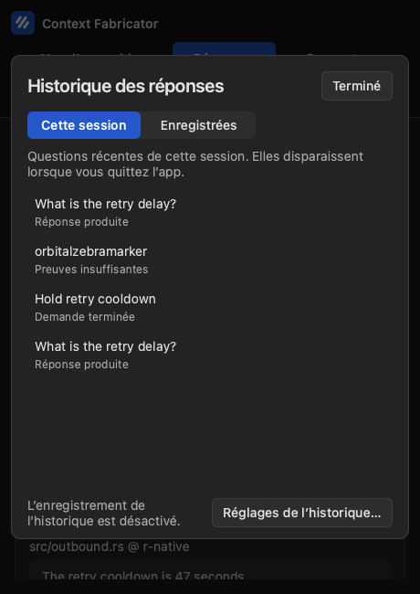](screenshots/qt/answer-history.png)

## Pipeline inspection

**Inspect Pipeline** puts corpus selection, retrieval, model input and verification in one window. The source panel lets you load pinned test corpora and public workflow runs. In **Benchmarks**, run a question or a suite and compare each answer with its expected result. The published status describes citation verification. [Pipeline architecture](../ARCHITECTURE.md#pipeline-inspection-and-benchmark-replay)

| Retrieved sources and candidates | Model input |
| --- | --- |
| [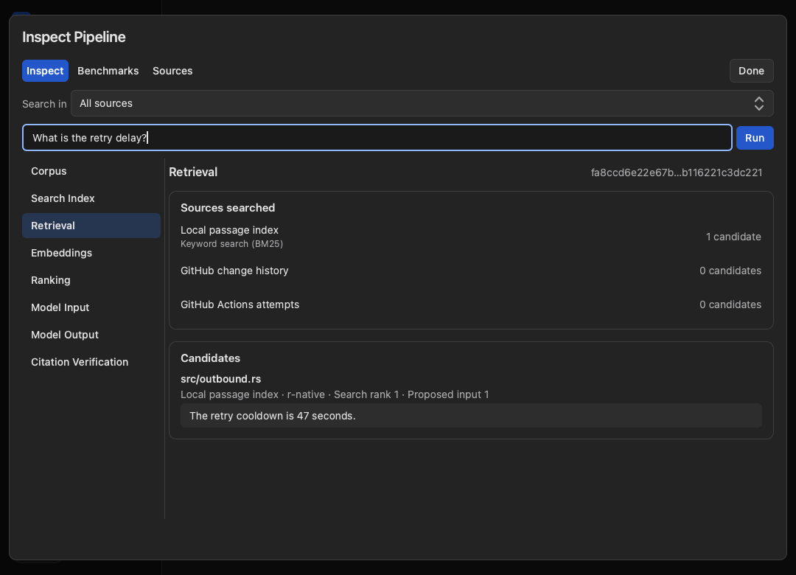](screenshots/qt/pipeline-retrieval.png) | [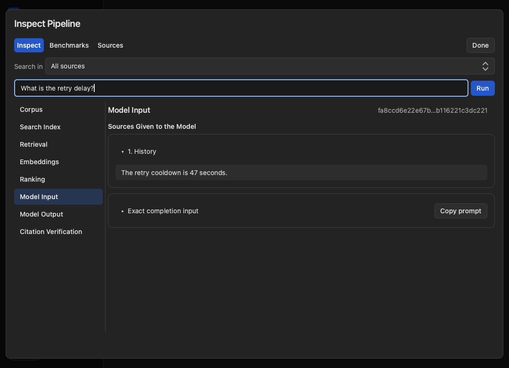](screenshots/qt/pipeline-model-input.png) |

| Benchmark question set | Benchmark results |
| --- | --- |
| [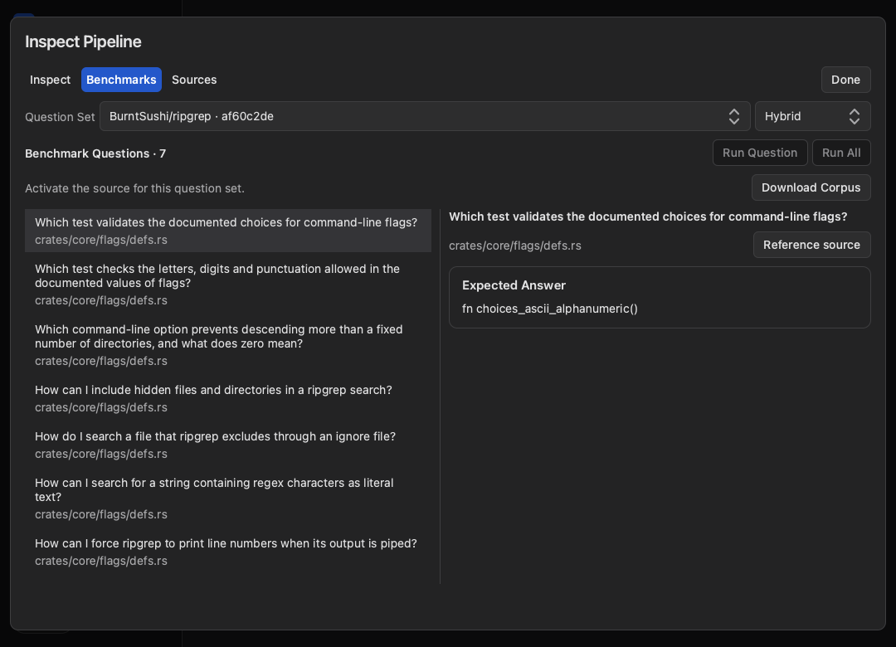](screenshots/qt/pipeline-benchmarks.png) | [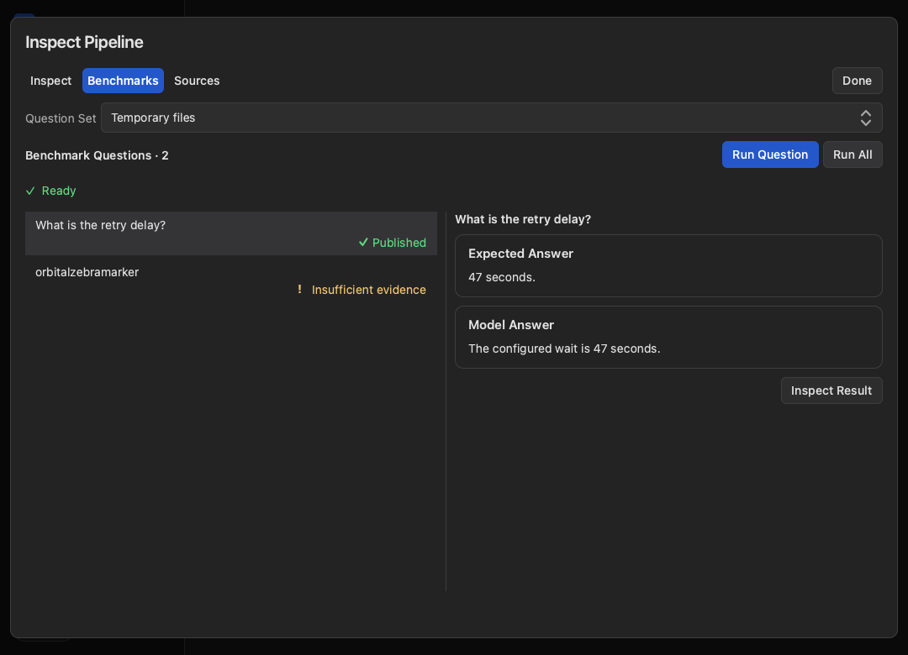](screenshots/qt/pipeline-results.png) |

## Model management

**Manage Models** displays generation and embedding profiles, installation sizes, setup and semantic indexing controls. [Local inference](../ARCHITECTURE.md#local-inference)

[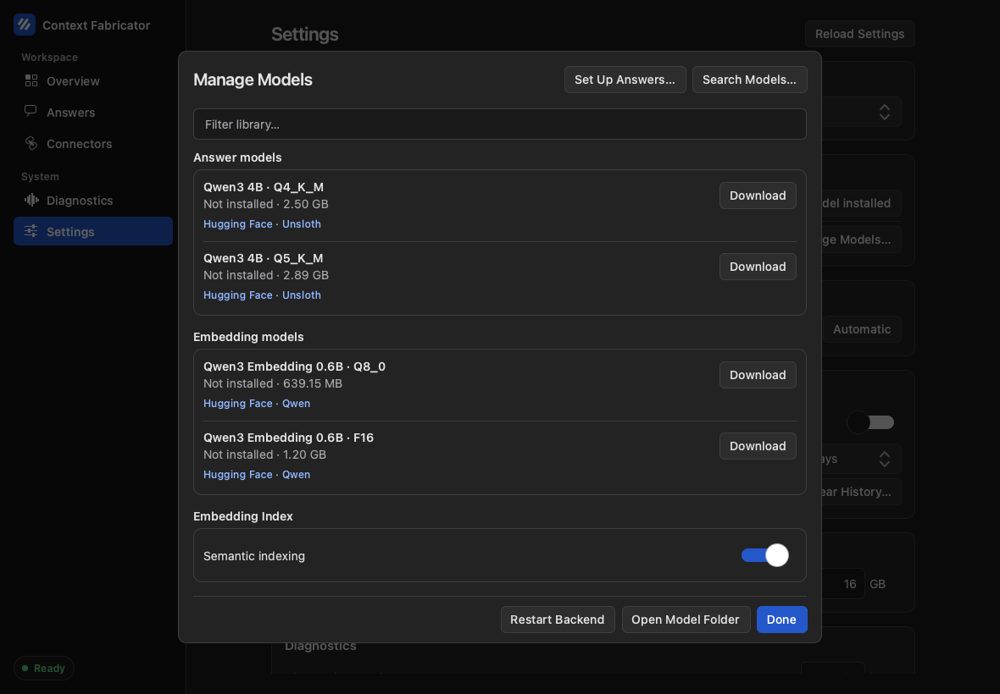](screenshots/qt/model-library.png)

## GitHub

Find a repository in the picker or enter its URL. The repository list shows the tracked branch and collection state. Benchmark workflow downloads are accessible from **Inspect Pipeline → Sources**.

| Repository picker | Configured repositories |
| --- | --- |
| [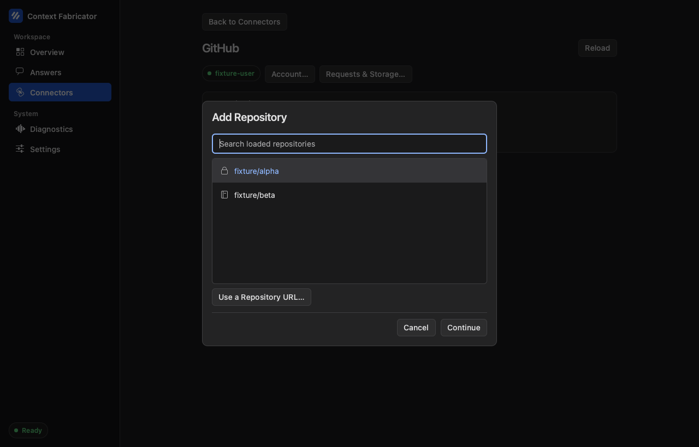](screenshots/qt/github-picker.png) | [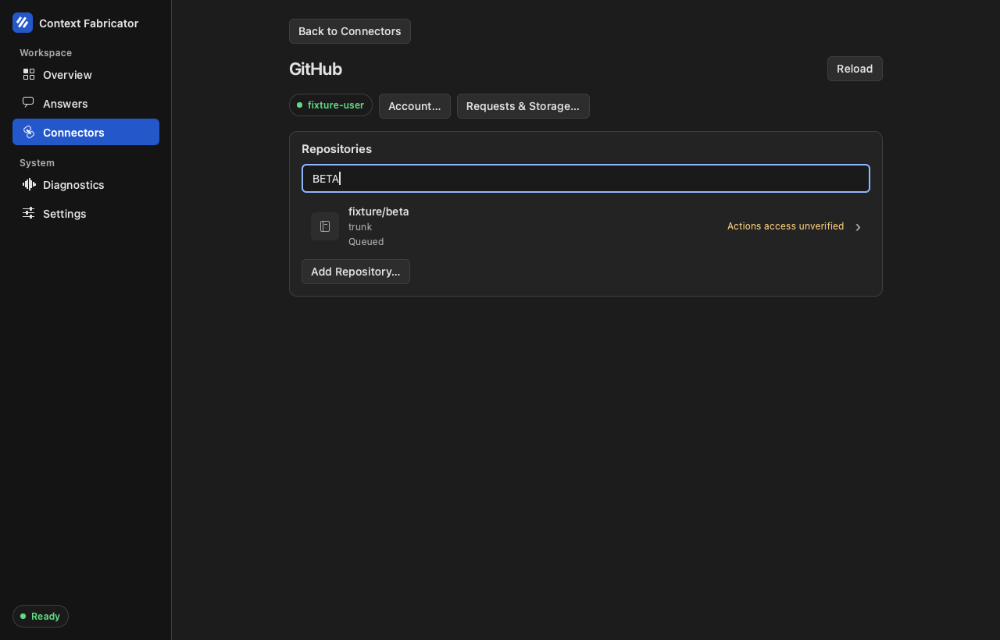](screenshots/qt/github-repositories.png) |

[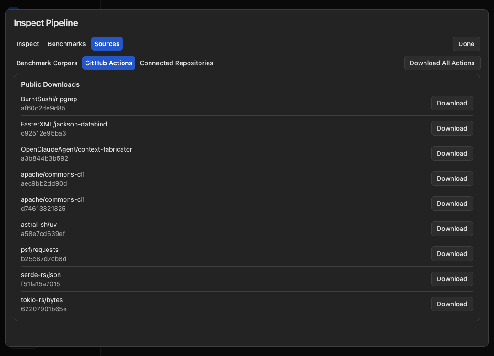](screenshots/qt/pipeline-actions.png)

## Diagnostics

Open the exact answer trace from **Requests** to inspect the evidence or switch to spans and logs. Requests distinguishes completed, interrupted and withheld answers.

| Requests | Answer trace |
| --- | --- |
| [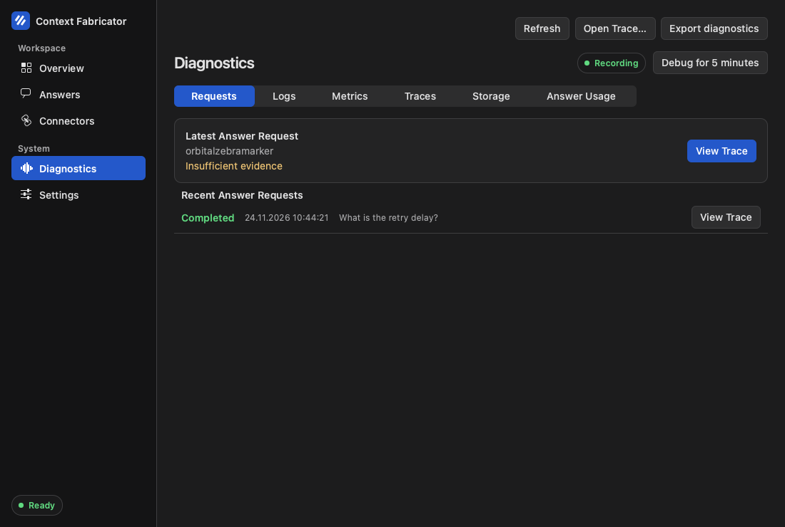](screenshots/qt/diagnostics-requests.png) | [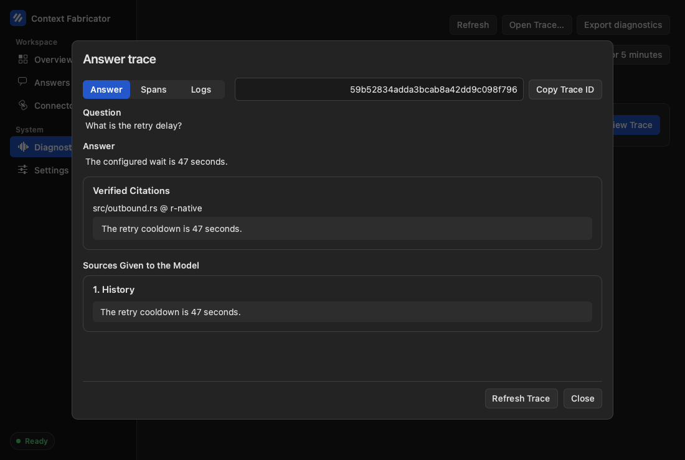](screenshots/qt/trace-inspector.png) |

## Overview and settings

**Overview** shows the searchable corpus, backend readiness and outbound activity. **Settings** provides separate interface and answer languages, model management, answer history and diagnostic limits.

| Overview | Settings |
| --- | --- |
| [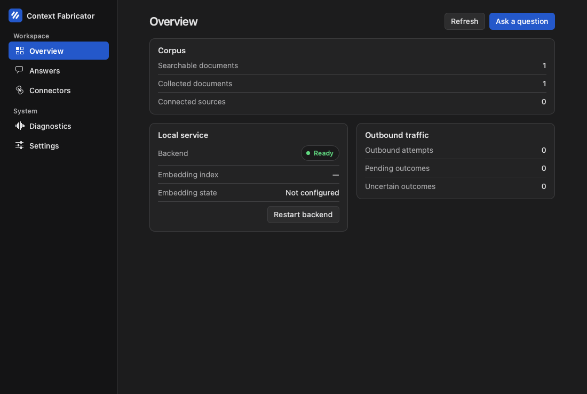](screenshots/qt/overview.png) | [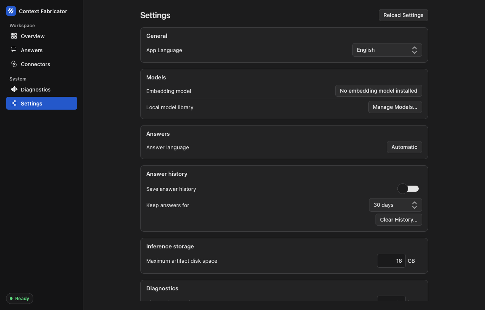](screenshots/qt/settings.png) |

| Searchable answer language | Compact Sources in French |
| --- | --- |
| [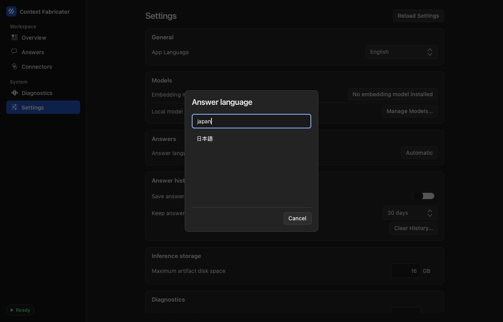](screenshots/qt/answer-language.png) | [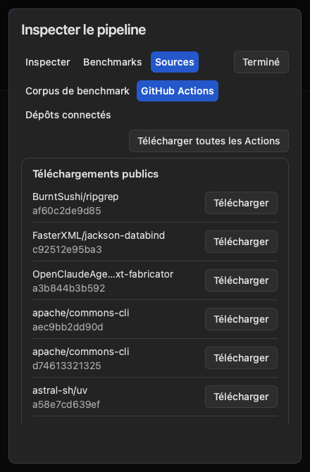](screenshots/qt/pipeline-sources-compact-fr.png) |

[Replay the window scenarios](../desktop/qt/README.md#rejouer-les-captures-de-la-fenêtre) · [Release preparation](RELEASE.md)
