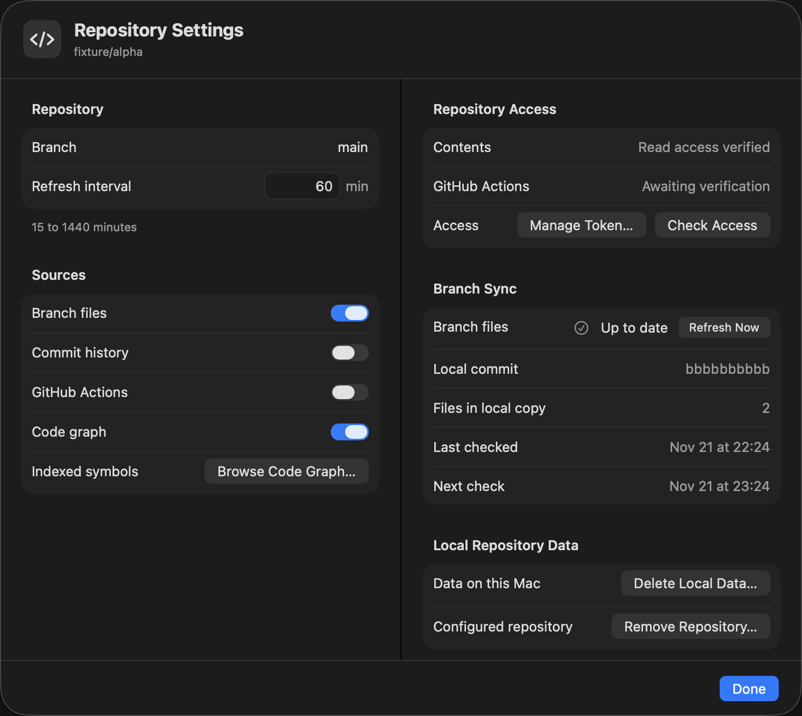
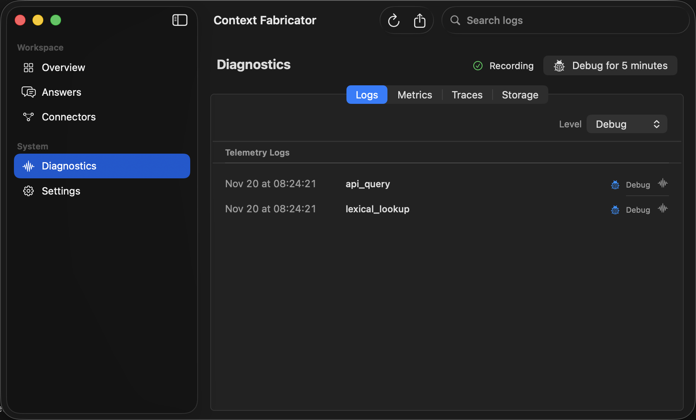
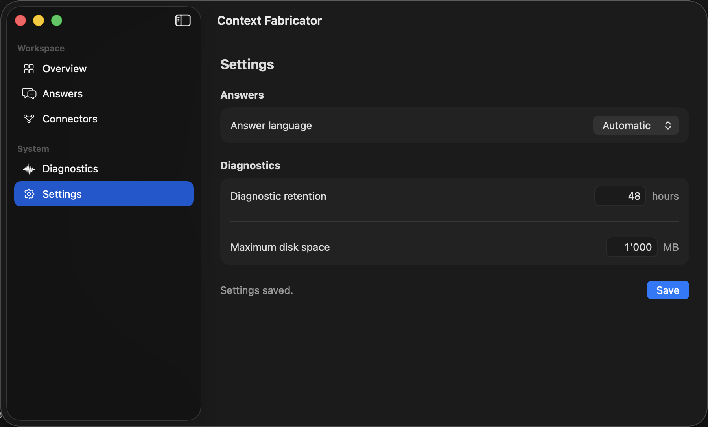

# Context Fabricator screenshot gallery

The current macOS preview, captured in native test sessions with synthetic repositories and data. The answer shown below comes from a fixture worker. Select any image to open it at full size.

[Answers](#local-answers) · [Model management](#model-management) · [GitHub](#github) · [Diagnostics](#diagnostics) · [Overview and settings](#overview-and-settings)

## Local answers

Ask a question about the local corpus. The answer displays its supporting excerpt, and **View Trace** opens the steps behind the result.

## Model management

**Manage Models** lists the available answer and embedding models, their download sizes, and their installation status. The preview uses a [manually installed inference runtime](../README.md#try-it-from-source).

## GitHub

Search repositories already loaded in the picker or enter a repository URL. Repository Settings shows the tracked branch, indexed commit, and refresh action. The Requests panel shows the effective pace limit and outbound activity.

| Select a repository | Check freshness | Inspect request activity |
| --- | --- | --- |
|  |  |  |

## Diagnostics

Search logs, filter by level, or enable debug logging for five minutes. Open a correlated trace from a log entry or an answer to inspect operation names, timings, events, and related logs.

## Overview and settings

**Overview** reports corpus counts, local service readiness, and outbound activity for the current session.

Use **Settings** to choose an answer language and adjust diagnostic retention and disk space. **Diagnostics → Storage** shows actual disk usage and lets you purge expired records.

| Settings | Diagnostic storage |
| --- | --- |
|  |  |
